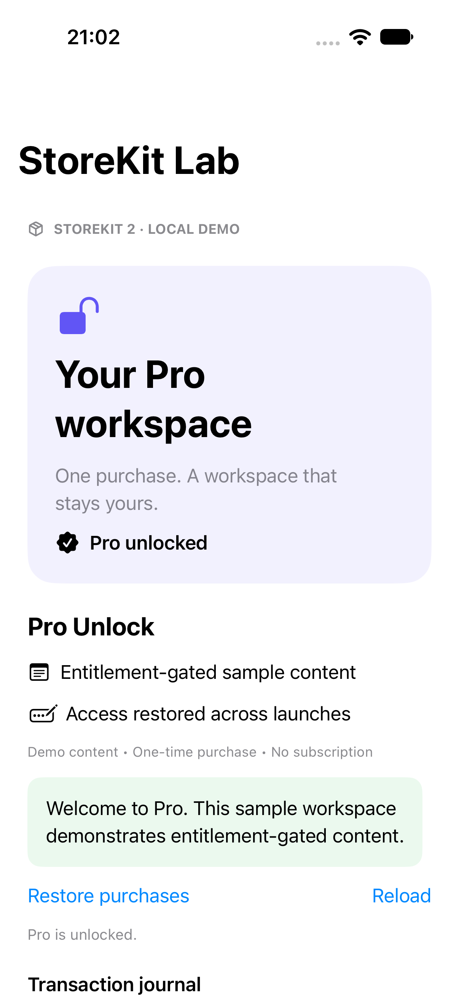

# StoreKit Lab

A focused SwiftUI + StoreKit 2 demo of a one-time **Pro Unlock** purchase. Built to make purchase state, entitlement recovery, and revocation easy to inspect.

## Run locally

1. Open `StoreKitLab.xcodeproj` in Xcode (iOS 17+ deployment target).
2. Select the **StoreKitLab** scheme and an iPhone simulator.
3. In Edit Scheme → Run → Options, confirm **Products.storekit** is selected.
4. Run and tap **Unlock Pro**. Local StoreKit transactions do not charge money and need no App Store Connect setup.

The price comes from `Product.displayPrice`. The included configuration defines a $4.99 USD non-consumable; it is sample data, not a live offering.

## What it demonstrates

- Product loading, retry, cancellation, pending approval, and failure feedback.
- Verified transactions only: an unverified purchase never grants access.
- An app-lifetime `Transaction.updates` listener with cancellation on teardown.
- Access rebuilt from `Transaction.currentEntitlements` on launch and foreground.
- User-initiated restore through `AppStore.sync()`.
- Content access updated before `finish()`; refund/revocation removes access.
- A bounded in-memory journal without receipt data or customer identifiers.

The Pro workspace is sample gated text, not a complete notes app. No purchase Boolean is persisted as an authority.

## Automated checks

Run **Product → Test** (⌘U). StoreKitTest controls the local store and disables payment dialogs. Tests run serially because Apple's local StoreKit environment is shared.

- Buy → unlock → relaunch → restore → refund → lock.
- Ask to Buy → pending without access → approve → unlock.

See [validation](docs/VALIDATION.md) for executed results and [case study](docs/CASE-STUDY.md) for design decisions.

## Scope

This independent demo uses original sample code and local test products. It includes no employer code or internal information. It does not implement subscriptions, consumables, server notifications, receipt infrastructure, or an App Store release. Local tests do not replace sandbox/device testing before shipping.

## References

- [Apple: current entitlements](https://developer.apple.com/documentation/storekit/transaction/currententitlements)
- [Apple: transaction updates](https://developer.apple.com/documentation/storekit/transaction/updates)
- [Apple: StoreKit test sessions](https://developer.apple.com/documentation/storekittest/sktestsession)
